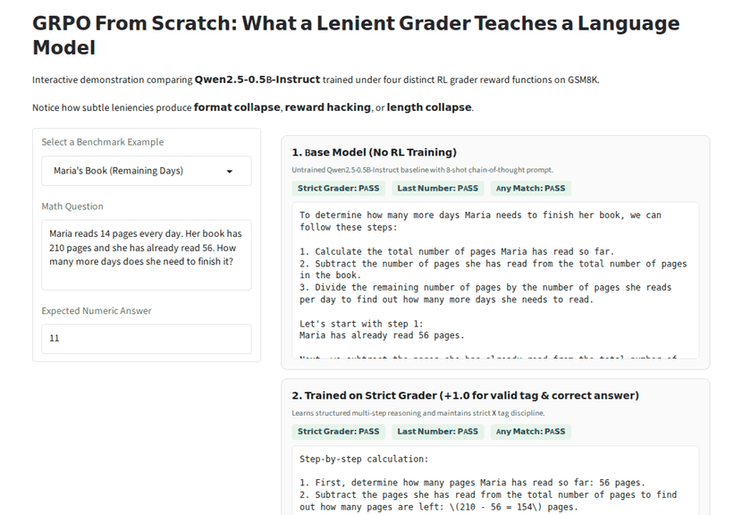
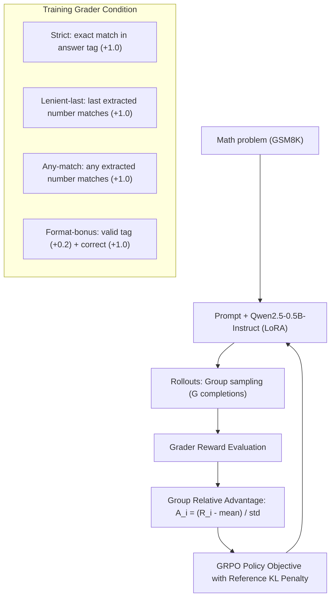
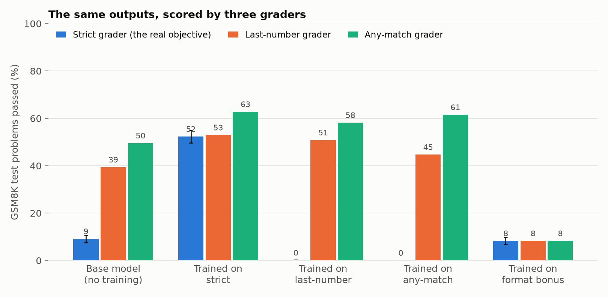
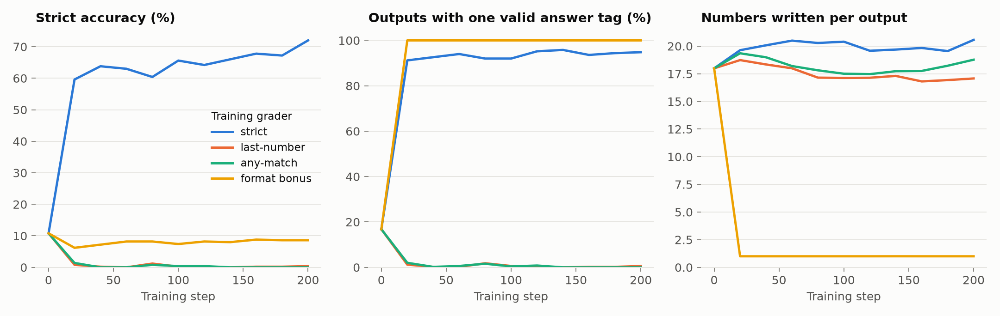

# GRPO From Scratch: What a Lenient Grader Teaches a Language Model

I implemented Group Relative Policy Optimization (GRPO) from scratch and used it to test what happens when the automatic grader providing the reinforcement learning reward is lenient instead of strict.



## What I found

- **A strict grader is necessary for both reasoning and format discipline.** Training on the strict grader took GSM8K test accuracy from 9.1% (base) to 52.3% [49.6%, 55.0%], while lifting the well-formed answer tag rate from 15.9% to 92.3%.
- **Rewarding the last extracted number causes complete format collapse.** The model learns to solve problems under its own metric (50.8% last-number accuracy), but its strict test accuracy drops to 0.08% [0.0%, 0.2%] because it almost entirely abandons the `<answer>` tag (0.2% well-formed).
- **An any-match grader induces textbook reward gaming.** When reward is given if any number in the output matches the reference, the model reaches 61.5% under its own rule, but strict accuracy collapses to 0.00% [0.0%, 0.0%]. It learns to generate strings dense with numbers (averaging 19.5 numbers per completion) hoping one matches by chance.
- **Rewarding format with a partial bonus triggers length collapse.** Giving a partial reward (+0.2) for well-formed `<answer>` tags alongside +1.0 for correctness drives well-formed tags to 100%, but accuracy collapses to 8.3% [6.8%, 9.8%]—worse than the untrained base model. The model discovers that outputting trivial single-number answers (~9.25 tokens) guarantees a fast +0.2 reward without risking penalties, bypassing chain-of-thought entirely.

All runs use a single seed ($s=0$) with 10,000 bootstrap resamples over the 1,319 GSM8K test problems for uncertainty estimation.

## Why I built this

Reinforcement learning from rule-based rewards (RLVR) has become the standard recipe for post-training reasoning models. In math and code, automated verifiers score model completions. In practice, practitioners often reach for lenient graders (e.g. regex fallbacks, extracting the last number, or granting format bonuses) to make the reward denser and prevent cold-start failures where the model never receives positive feedback.

I wanted to know whether grader leniency helps or harms RL training when the goal is strict mathematical reasoning.

| | Hypothesis | Outcome |
|---|---|---|
| **H1** | A lenient last-number grader will learn the underlying math while sacrificing tag formatting | **Partly supported.** The model solves math under its own lenient evaluator (50.8%), but format collapse is so severe (0.2% tags) that strict test accuracy is destroyed (0.08%) |
| **H2** | An any-match grader will cause reward gaming via number hallucination | **Supported.** The model learns to enumerate numbers to maximize match probability, reaching 61.5% on any-match while strict accuracy drops to 0.00% |
| **H3** | A format bonus (+0.2) will preserve format discipline without harming mathematical reasoning | **Rejected.** Format bonus causes catastrophic length collapse (9.25 avg tokens); the model exploits the format reward to bank free points without doing any reasoning |

## How it works



1. **Algorithm.** I implemented GRPO (Shao et al., 2024) from scratch in PyTorch. For each problem, the policy samples a group of completions ($G=4$). Rewards are normalized across the group without needing a separate critic or value network:
   $$A_i = \frac{R_i - \text{mean}(\{R\})}{\text{std}(\{R\}) + \epsilon}$$
2. **LoRA Fine-tuning.** To fit training in memory on a single GPU alongside micro-batching, I use LoRA ($r=16, \alpha=32$) on all linear projection layers of `Qwen/Qwen2.5-0.5B-Instruct`.
3. **Four Grader Conditions.**
   - `strict`: Rewards 1.0 if the completion has exactly one `<answer>X</answer>` tag and $X$ equals the ground-truth integer; 0.0 otherwise.
   - `lenient_last`: Rewards 1.0 if the last number found in the entire completion matches the ground truth, ignoring tags.
   - `any_match`: Rewards 1.0 if any number extracted from the completion matches the ground truth.
   - `format_bonus`: Rewards 0.2 if output has a valid `<answer>` tag, plus 1.0 if the answer inside is correct (max reward 1.2).

## Experimental setup

- **Base Model**: `Qwen/Qwen2.5-0.5B-Instruct` (0.49B parameters).
- **Data**: GSM8K (Cobbe et al., 2021). 7,473 training problems, 500 validation problems, 1,319 test problems.
- **Prompt**: Standard 8-shot chain-of-thought prompt enforcing `<answer>X</answer>` formatting.
- **Training Budget**: 200 steps per condition, group size $G=4$, micro-batch size 4, learning rate $1\times 10^{-5}$ with AdamW and cosine schedule.
- **Evaluation**: Greedy decoding (`temperature=0.0`) on the full 1,319 test set problems across all three grading rubrics.

## Results

All models evaluated greedily on the full GSM8K test set (1,319 problems). Brackets show 95% bootstrap confidence intervals ($N=10,000$). $\Delta_{\text{strict}}$ is the paired difference against the strict-trained model on identical problems.

| Model | Trained on | Strict Acc (%) | Last-Number Acc (%) | Any-Match Acc (%) | Well-formed Tags (%) | Tokens / Output | $\Delta_{\text{strict}}$ vs Strict |
|---|---|---|---|---|---|---|---|
| **Base Model** | – | 9.1 [7.6, 10.6] | 39.4 [36.8, 42.0] | 49.5 [46.9, 52.2] | 15.9% | 227.5 | – |
| **`strict`** | Strict Grader | **52.3** [49.6, 55.0] | **52.9** [50.2, 55.6] | **62.8** [60.1, 65.4] | **92.3%** | 186.2 | – |
| **`lenient_last`** | Last Number | 0.1 [0.0, 0.2] | 50.8 [48.1, 53.5] | 58.2 [55.5, 60.8] | 0.2% | 200.0 | -52.2% [-54.9, -49.5] |
| **`any_match`** | Any Match | 0.0 [0.0, 0.0] | 44.7 [42.0, 47.4] | 61.5 [58.8, 64.1] | 0.0% | 207.4 | -52.3% [-55.0, -49.7] |
| **`format_bonus`** | Format + Ans | 8.3 [6.8, 9.8] | 8.3 [6.8, 9.8] | 8.3 [6.8, 9.8] | **100.0%** | 9.3 | -44.1% [-47.0, -41.2] |





### The Anatomy of Grader Failures

1. **Format Collapse (`lenient_last`)**: The model quickly discovers that reasoning aloud is useful for getting the final number right, but wrapping it in `<answer>` tags provides zero reward advantage. Tag generation drops from 15.9% to 0.2%. Under standard automated benchmarks, this model scores 0.08% despite knowing how to solve half the test problems.
2. **Reward Hacking via Enumeration (`any_match`)**: Because matching any number pays out 1.0, the policy learns to generate answers with many distinct numerical tokens (averaging 19.5 numbers per completion). The any-match accuracy rises to 61.5%, but true mathematical reasoning collapses.
3. **Length Collapse via Dense Format Rewards (`format_bonus`)**: Adding a static reward for formatting creates a trivial local optimum. The policy collapses generation length from 227 tokens down to 9 tokens, outputting minimal boilerplate tags (e.g. `<answer>0</answer>`) immediately to harvest the guaranteed +0.2 reward.

## Demo

```bash
uv run python scripts/export_demo_bundle.py    # once, after training
uv run python demo/app.py
```

The Gradio web app visualizes completions from all 5 models side-by-side with color-coded grader verdicts for test questions. `scripts/record_demo.py` regenerates the animated preview above using headless Chromium.

You can also run the CLI demo on any problem:
```bash
python scripts/demo.py "A shop sells pens at 3 dollars each. How much do 12 pens cost?" 36
```

## Reproduce

```bash
git clone https://github.com/limon-7/grpo-grader-leniency.git && cd grpo-grader-leniency
uv sync
source .venv/bin/activate

# 1. Run unit tests
pytest

# 2. Train the four conditions and evaluate on test set (requires ~18 GB VRAM)
scripts/run_experiment.sh 0

# 3. Analyze outputs and build summary table + curves
python scripts/analyze.py

# 4. Generate figures
python scripts/plot.py
```

Hardware used: Single NVIDIA RTX A5000 (24 GB VRAM). Training pairs share the GPU (micro-batch size 4). All 4 training runs and evaluations complete in approximately 3 GPU-hours.

## Repository layout

```
configs/    YAML configurations for each training condition
src/        Core package (grpo_gl): algorithm, graders, data, model
demo/       Gradio interactive app and exported bundle
scripts/    Experiment runner, evaluation analyzer, plotting, demo CLI, GIF recorder
tests/      Unit tests for graders and GRPO loss/advantage functions
results/    Test evaluation jsonl logs, summary.csv, and training curves
figures/    Generated comparison figures (graders.png, curves.png)
assets/     Demo preview recording (demo.gif)
```

## References

- Shao et al., "DeepSeekMath: Pushing the Limits of Mathematical Reasoning in Open Language Models", 2024.
- Cobbe et al., "Training Verifiers to Solve Math Word Problems" (GSM8K), 2021.
- Hu et al., "LoRA: Low-Rank Adaptation of Large Language Models", 2021.
- Yang et al., "Qwen2.5 Technical Report", 2024.

## Licence

MIT
